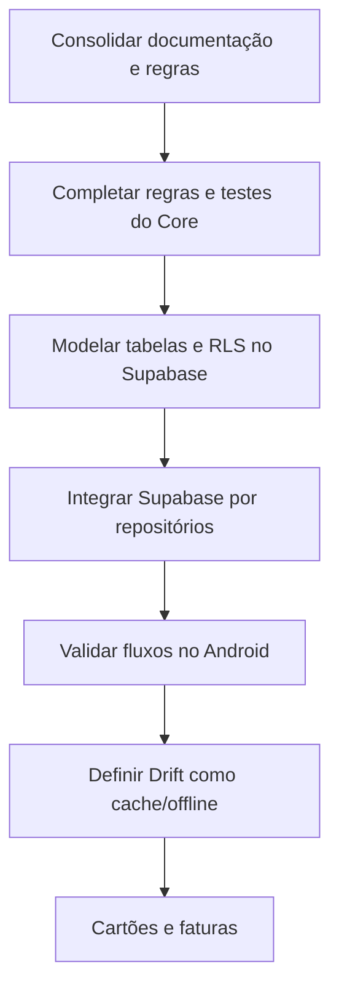

# Plano de Ação e Guia de Continuidade — MeuSaldo

Este documento registra o estado do MVP e a sequência autorizada de evolução. Leia-o junto de `docs/AI_CONTEXT.md` e `docs/ARCHITECTURE.md` antes de iniciar uma nova implementação.

## Princípios inegociáveis

- O Core (`packages/meusaldo_core`) é Dart puro: sem Flutter, Drift, Supabase, HTTP ou widgets.
- Todo valor financeiro usa `Money` em centavos inteiros; `double` é proibido para dinheiro.
- Uma transferência é atômica: débito e crédito ocorrem juntos e não alteram o patrimônio consolidado.
- Saldo atual considera apenas movimentações `completed`.
- Saldo previsto considera movimentações `completed` e `pending` aplicáveis ao período.
- Movimentações podem ser criadas, confirmadas, corrigidas e excluídas. Cada alteração deve reverter o efeito anterior e aplicar o novo efeito de forma atômica.
- Arquivos `*_screen.dart` orquestram a tela e têm meta de até 150 linhas.
- Cada entrega é pequena, testável e aguarda a confirmação do usuário antes da seguinte. Os comandos Git são fornecidos para execução manual pelo usuário.

## Estado atual

### Concluído

- Core financeiro: `Money`, erros/resultados, contas, categorias, transações, transferências, contratos de repositório e cálculos de saldo.
- Fundação Flutter: tema Dark Burgundy, componentes compartilhados, `go_router` e Riverpod.
- Fluxo visual MVP: Início, Contas e Lançamentos, incluindo formulários e detalhes de lançamento.
- Infraestrutura local: Drift configurado com tabelas de contas, categorias e lançamentos, conversores, mapeadores, `AppDatabase` e testes iniciais.

### Estado transitório

- As features ainda consomem repositórios em memória.
- O banco Drift não está ligado aos providers como fonte de produção.
- Dados de demonstração são usados para desenvolvimento e não devem ser confundidos com dados iniciais de um usuário real.
- Supabase foi escolhido como a futura fonte remota. O SDK, autenticação e as tabelas ainda não foram integrados ao app.

## Sequência de implementação



## Próxima entrega autorizada: documentação e decisões

1. Manter `AI_CONTEXT`, arquitetura, dependências, guia de desenvolvimento e README coerentes com o estado atual.
2. Registrar Supabase como backend remoto planejado, sem adicioná-lo ao Core.
3. Diferenciar formalmente saldo atual de saldo previsto.
4. Registrar que `pending` não altera saldo atual e que correções/exclusões exigem recálculo atômico.
5. Definir o tratamento de arquivos gerados pelo Drift: `*.g.dart` não é editado manualmente e permanece versionado quando necessário para compilar.

## Próxima implementação após a confirmação do usuário

### 1. Fechar regras do Core

- Cobrir com testes: pendente versus confirmado, confirmação posterior, edição e exclusão de receita, despesa e transferência.
- Explicitar o cálculo de saldo previsto no Core.
- Garantir que atualização de uma transação não deixe saldos intermediários inconsistentes.

### 2. Modelar Supabase

Criar a modelagem e a migração SQL antes de conectar o app:

- `profiles`;
- `financial_accounts`;
- `categories`;
- `transactions`.

Exigências da modelagem:

- valores em centavos inteiros;
- `user_id` em todo dado privado;
- relações entre conta, categoria e lançamento;
- status de pendência/confirmação;
- origem e destino para transferência;
- índices por usuário, conta, período e status;
- Row Level Security para isolamento entre usuários.

### 3. Integrar o app gradualmente

1. Adicionar `supabase_flutter` ao app e configurar o cliente fora do Core.
2. Implementar autenticação mínima.
3. Implementar repositório remoto de contas.
4. Implementar repositório remoto de categorias.
5. Implementar repositório remoto de lançamentos com operações atômicas.
6. Trocar os providers Riverpod, preservando as interfaces do Core.
7. Exibir estados de carregamento, erro e vazio nas telas.

### 4. Validar no Android

Ao final de cada entrega de código, rodar apenas as verificações necessárias:

```powershell
cd packages/meusaldo_core
dart analyze
dart test

cd ../../apps/meusaldo
flutter analyze
flutter test
```

`flutter run` fica para a validação manual posterior, quando solicitado pelo usuário.

## Roadmap posterior

1. Definir e implementar cache/offline com Drift, caso continue necessário após Supabase.
2. Cartões de crédito e faturas.
3. Categorias personalizadas, recorrências, agenda e orçamentos.
4. Relatórios, configurações, backup e exportação.
5. PWA/iPhone e aplicação web desktop são etapas futuras; não fazem parte do MVP Android atual.
